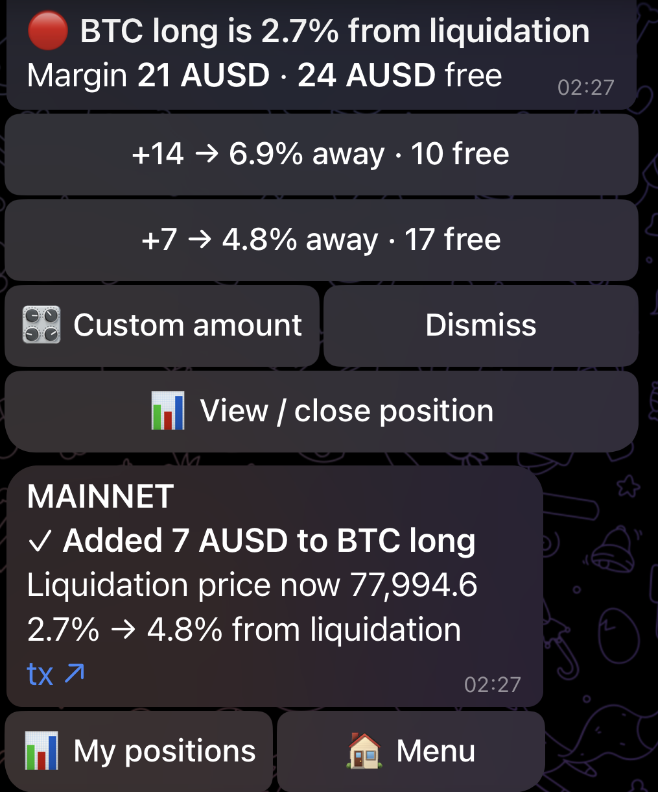

# PerpGuard: submission notes

Monad Metropolis, Track 01, Onchain Finance & Trading. Bounties: Envio, Perpl analytics and risk, Perpl API, Dynamic.

Every figure below names its window and where it was read. Readings marked "14 Oct 2026" were taken from the running system between 00:20 and 01:30 UTC that day.

## 1. What it is

Perpl is a perpetuals exchange on Monad where each position has its own collateral, and the spare money in a trader's account is never used to save a losing position. PerpGuard watches positions, sends a Telegram message before one is liquidated, and lets the trader add collateral or close with a tap. It also publishes a public analytics site built from the exchange's whole on-chain history.

## 2. Links

- Site (mainnet): https://perpguard.app
- Bot (mainnet): [@PerpGuardBot](https://t.me/PerpGuardBot)
- Setup guide for the testnet deployment, which costs nothing to try: https://testnet.perpguard.app/bot/guide
- Source: https://github.com/0xMigzy/PerpGuard

### Videos

| | |
| --- | --- |
| Technical demo | https://youtu.be/9BkDO-LJDYc |
| Pitch | https://youtu.be/tb30wU6i5Vc |
| Perpl Analytics | https://youtu.be/aL0GMj1EZJU |
| Perpl API | https://youtu.be/twGDTjJM8W4 |
| Envio | https://youtu.be/UO7vfAl6F_s |
| Dynamic | https://youtu.be/g4MERKS9eAg |

## 3. The finding

From Perpl's launch on 11 Feb 2026 to 13 Oct 2026, 2,444 of 3,682 mainnet liquidations (66.4%) were rescuable. The first liquidation in the index is on 15 Feb 2026 and the latest on 13 Oct 2026, 05:23 UTC. All 3,682 could be judged: none is excluded for a missing entry price.

**Rescuable, precisely.** For each `PositionLiquidated` event the indexer computes two numbers:

- `marginToSurvive`: the collateral that, added to the position, would have put it exactly at maintenance margin at the mark price it was liquidated on. It is computed from the position's side, size, entry price and collateral before the event, and the market's maintenance margin fraction (`marginToSurviveCNS` in `packages/shared/src/risk/liquidation.ts`).
- `freeBalanceBefore`: the account's free AUSD immediately before the event, taken from the event itself as the balance after minus the amount the event applied.

A liquidation is rescuable when `marginToSurvive > 0` and `freeBalanceBefore >= marginToSurvive` (`apps/indexer/src/handlers/liquidations.ts`).

What the definition does not say: that a warning would have arrived in time, or that the trader would have acted on it. The top-up it measures leaves the position at the threshold, not clear of it. Funding accrued since the last settlement is taken as zero, because the contract publishes none between settlements.

**Potentially avoidable losses: 429,926 AUSD (429.9K), 11 Feb to 13 Oct 2026.** This is the realised loss (PnL plus funding) summed over the 2,444 rescuable liquidations, once per event (`rescuableRealisedLossAusd`, served by `/api/analytics/metrics`, computed 14 Oct 2026 00:23 UTC). It leaves out trading and liquidation fees, so it understates. It is not money the traders would have kept: a top-up keeps a position open, it does not undo the price move.

**How much room they had.** Across the same 2,444, the median ratio of free balance to the top-up needed was 178 to 1 (11 Feb to 13 Oct 2026).

**The recent window.** Over the 30 days to 13 Oct 2026: 371 of 552 (67.2%), with 44,125 AUSD of realised loss on the 371.

## 4. Two deployments from one codebase

| | Mainnet | Testnet |
| --- | --- | --- |
| Bot | [@PerpGuardBot](https://t.me/PerpGuardBot) | [@PerpGuardTestnetBot](https://t.me/PerpGuardTestnetBot) |
| Site | https://perpguard.app | https://testnet.perpguard.app |
| Backend service | `perpguard-backend` | `perpguard-backend-testnet` |
| Chain for actions | Monad mainnet, chain 143, real funds | Monad testnet, chain 10143 |
| Analytics and the watch tier | Monad mainnet | Monad mainnet |

The two backends are the same code started from two complete env files. On 14 Oct 2026 both services were running, and the two files differed in database URL, key-encryption key and Telegram bot token (compared by hash, values not read out). Both point at the same read-only mainnet index.

Actions run on both: add margin, partial close, full close, the automatic top-up (Rescue) and the kill switch. A link stores its network. A wallet whose account is on the other network is refused by name and pointed at the other bot.

The web app is one codebase built twice. One build-time value, `NEXT_PUBLIC_TRADING_NETWORK`, decides every sentence that names a network.

## 5. The Envio HyperIndex

- **Start block:** 54,773,010, the Exchange proxy's deployment block on Monad mainnet (block time 11 Feb 2026, 23:02 UTC). Proxy address `0x34B6552d57a35a1D042CcAe1951BD1C370112a6F`.
- **Events processed:** 85,243,770 at block 113,194,373, 121 blocks behind the chain head, read from the index on 14 Oct 2026 at 01:21 UTC.
- **Source:** Envio HyperSync (`143.hypersync.xyz`), with no RPC in the indexing path. The full backfill took about 14 hours on a 2-vCPU server (1 Oct 2026, 06:12 to 20:28 UTC).
- **Coverage:** 42 of the 204 event types in the Exchange ABI have handlers. `apps/indexer/docs/EVENTS.md` lists all 204 and how each is treated.

What the handlers derive (`apps/indexer/src/handlers/`, schema in `apps/indexer/schema.graphql`):

| Handler | Derives |
| --- | --- |
| `accounts.ts` | The wallet to account id link, and each account's free balance from deposits and withdrawals. |
| `markets.ts` | Each market's scaling and margin parameters, mark price observations and funding settlements. |
| `positions.ts` | Every position's open, increase, decrease and close, with realised PnL and funding per round trip. |
| `trades.ts` | One fill per match from the maker event, with the taker's fee from the taker event. Market volume counts a match once; trader volume counts it for each side. |
| `margin.ts` | Collateral added to and removed from a position. |
| `liquidations.ts` | Each liquidation with the margin lost, the free balance just before it, the top-up that would have saved it, and the rescuable verdict in section 3. |
| `exchange.ts` | Exchange-wide state: the halt switch and proxy upgrades. |

On top of these the handlers keep running totals per trader and per market, and per-day rows by market and by trader, which the site's windows are read from.

## 6. Mainnet proof

Both actions below were sent from @PerpGuardBot on mainnet account #69 with real funds, on the same BTC position (`7398022643720`). Figures are from the mainnet deployment's `action_log` (rows 3 and 4). Block numbers, block times, status and recipient were read from the chain on 14 Oct 2026: both receipts have status `0x1` and are addressed to the Exchange proxy.

**Add margin, 11.5 AUSD**

| | |
| --- | --- |
| Transaction | `0x1926fd3cb0a44f5aa21b736a11b656627d89e1ff0809436a7c71d9bb449d3f9c` |
| Block | 112,885,275 |
| Block time | 12 Oct 2026, 23:25:16 UTC |
| Sent / settled by PerpGuard | 23:25:13.917 / 23:25:17.096 UTC |
| Margin before | 17.416539 AUSD |
| Margin after | 28.916539 AUSD |
| Applied / requested | 11.500000 / 11.500000 AUSD |
| Perpl's report | `st: 7 Failed, sr: 32 OrderDescIdTooLow` |
| PerpGuard's verdict | applied, judged by the position's margin before and after. Nothing was sent again. |

Explorer: https://monadvision.com/tx/0x1926fd3cb0a44f5aa21b736a11b656627d89e1ff0809436a7c71d9bb449d3f9c

**Close position, full**

| | |
| --- | --- |
| Transaction | `0xed222cfbefc0b30e39148db1550728231a7589fd187ef2c843b0b10f92c48905` |
| Block | 112,885,716 |
| Block time | 12 Oct 2026, 23:27:29 UTC |
| Sent / settled by PerpGuard | 23:27:29.072 / 23:27:30.124 UTC |
| Size before | 315 size units |
| Size after | 0: the position left the account's position list |
| Perpl's report | confirmed |
| PerpGuard's verdict | applied, judged by the position list afterwards |

Explorer: https://monadvision.com/tx/0xed222cfbefc0b30e39148db1550728231a7589fd187ef2c843b0b10f92c48905

The close's margin before and after is not given: the log records size for a close, not margin.

**The wider record.** From 12 Oct 2026 20:18 UTC to 13 Oct 2026 20:08 UTC the mainnet deployment logged 20 actions on account #69: 10 add-margin, 9 full closes and 1 partial close. All 20 were judged applied from the position. Of the 10 add-margins, 8 came back from Perpl as `st 7 / sr 32` and 2 timed out with no report; all 10 were credited in full, by exactly the amount sent, and none was sent twice.

**Limit of this evidence.** One account, one market. The raw order-update frames were not captured to a fixture on mainnet, so Perpl's report is as the venue adapter decoded it. Verbatim frames exist for testnet only (`fixtures/live-action-run-testnet.json`, `docs/evidence.md`).

## 7. The Perpl builder code

On the mainnet deployment, a key PerpGuard creates through the wallet signature on `/link` carries PerpGuard's Perpl builder code. It is bound at enrolment: two fields on the enrolment payload request (`builder_id`, `max_builder_fee_per_100k`), fixed for that key from then on. The fee ceiling is 0 per 100k, so this is attribution with no builder fee. The mainnet backend's start-up log on 14 Oct 2026 reads "fee ceiling 0 per 100k".

The wallet prompt names the builder and the ceiling before anything is signed. A pasted key, or one enrolled earlier, never carries the code. The testnet deployment sends none. The builder id itself is configuration and is not in the repository.

## 8. Security

- **Trade-only keys.** PerpGuard acts with a Perpl API key. Perpl's documentation states: "Withdrawals and transfers-out are never permitted via an API key, regardless of scope." Those need a wallet signature on the Exchange contract ([authentication](https://docs.perpl.xyz/resources/for-developers/api/authentication.md), read 14 Oct 2026).
- **Sealed at rest.** Each key is encrypted with AES-256-GCM before it is stored (`apps/backend/src/server/link/crypto.ts`).
- **Master key from the environment.** The encryption key is read from an environment variable, `PERPGUARD_KEY_ENCRYPTION_KEY`, and is never written to the repository or the database. Each deployment has its own. If it is rotated, the stored keys become unreadable and each person links again; nothing is re-encrypted or kept in the clear.
- **The key does not come back out.** It is entered only on the HTTPS page, or created by the backend after one wallet signature so that the secret never reaches the browser. No route returns it and it is not logged.
- **Nothing automatic by default.** Every button amount needs a second tap. Rescue is off on every position until its owner arms it with a tap in the linked chat.

## 9. What this looks like in practice

One manual top-up on mainnet, from the alert to the transaction. It is row 10 of the mainnet deployment's `action_log`, on account #69, on 13 Oct 2026. The figures come from three places, named on each line: the action log, the backend's log file, and the screenshot of that chat kept in the repository (`docs/screenshots/alert-to-tx.png`, committed 13 Oct 2026 at 01:44 UTC). The screenshot is matched to the log row by its amount (7 AUSD), its margin (21 AUSD) and its clock (02:27, which is 01:27 UTC if the phone was on GMT+1).

1. **The position.** A BTC long of 395 size units (action log, the close that followed) holding 21.580720 AUSD of margin (action log). The account had 24 AUSD free (screenshot).
2. **The alert.** The account's alert distance was set to 2.7%. The backend logged the crossing at 2.66% from liquidation (backend log: "reached 2.66%, alert at 2.7%"). The message read "BTC long is 2.7% from liquidation" (screenshot).
3. **What it offered.** Two amounts, each stating the distance it would buy and the free balance it would leave (screenshot):
   - +14 AUSD: 6.9% from liquidation, 10 AUSD left free.
   - +7 AUSD: 4.8% from liquidation, 17 AUSD left free.
   - Also a custom amount, Dismiss, and View / close position.
4. **What was tapped.** +7 AUSD (action log: 7,000,000 micros requested), then the confirmation.
5. **Margin before and after.** 21.580720 AUSD to 28.580720 AUSD: 7.000000 applied of 7.000000 requested (action log).
6. **The new liquidation price.** 77,994.6 (screenshot of the result message).
7. **The distance after.** 4.8% from liquidation, from 2.7% (screenshot), which is the figure the button stated.
8. **The transaction.** `0xd28afbaa461f070509b6a252e5c11118ab6864b006859ef31b72cbbd9c9b5906`, block 112,909,599, block time 13 Oct 2026 01:27:42 UTC, status `0x1`, addressed to the Exchange proxy (chain, read 14 Oct 2026). https://monadvision.com/tx/0xd28afbaa461f070509b6a252e5c11118ab6864b006859ef31b72cbbd9c9b5906
9. **How long it took.** 2.908 seconds from the confirmed tap to the verified result: sent 01:27:40.713 UTC, included in a block stamped 01:27:42 UTC, settled 01:27:43.621 UTC (action log and chain).

Perpl reported this top-up as `st: 7 Failed, sr: 32 OrderDescIdTooLow`. PerpGuard read the position's margin, recorded it as applied, and sent nothing again (action log). The position was closed in full 99 seconds after the top-up was sent, in block 112,909,922 (action log row 11; chain).

**What could not be sourced, and is left out:**

- The time from the alert to the tap. The alert's send time is not stored for this position, and the backend log has no timestamps. The screenshot shows the alert and the result in the same minute, and nothing finer.
- The liquidation price before the top-up, the mark price at the alert, and the position's entry price. None is in the action log, and the alert message does not print them.
- The liquidation price and distance after are from the screenshot of the bot's message, not from a stored row: the action log keeps margin before and after for a top-up, not the price.
